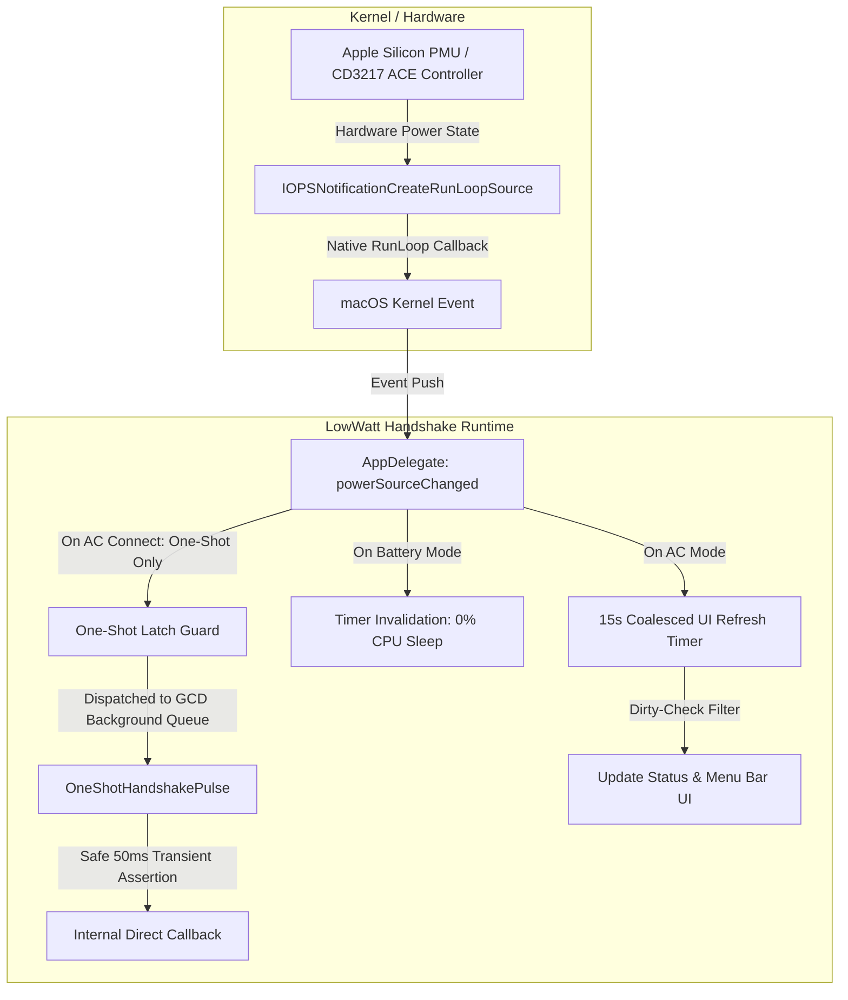

# LOWWATT_HANDSHAKE_ARCHITECTURE.md
## System Architecture Blueprint: LowWatt Handshake macOS

---

### 1. High-Level System Overview
`LowWatt Handshake macOS` is an ultra-lightweight, native menu bar utility for Apple Silicon & Intel macOS hardware. It enables reliable Type-C PD handshake negotiation with low-wattage (5W–30W) power sources, portable power banks (e.g. Anker), and non-standard USB-PD adapters without triggering thermal throttling or kernel power management lockouts.



---

### 2. Subsystem Boundaries & Data Flow
1. **Event-Driven Push Layer (`IOPSNotificationCreateRunLoopSource`)**:
   - Replaces all legacy 5Hz polling on battery power.
   - Listens passively to the kernel runloop for physical power cable insertion or removal.
   - On AC disconnect: immediately tears down periodic timers, entering 0% CPU sleep.

2. **One-Shot Handshake Engine (`executeHandshakePulseAsync`)**:
   - Executes strictly once (`hasExecutedHandshakeOnThisConnection = YES`) per physical plug-in event.
   - Offloaded entirely to GCD global background queue (`DISPATCH_QUEUE_PRIORITY_HIGH`), eliminating all main-thread blocking.
   - Issues short, non-invasive power assertion bursts without poking internal I2C bus controllers (`AppleTCControllerType10` eliminated).

3. **Dirty-Checked UI Presentation Layer (`updateStatus`)**:
   - Compares 6 critical power metrics (`connected`, `charging`, `percentage`, `watts`, `timeRemaining`, `isLowWatt`) against previous state.
   - If unchanged: skips 100% of bitmap generation, CoreGraphics rasterization, and `NSMenu` rebuilds.
   - If changed: creates dynamic cached status item title/icon.

4. **Safety & Hardware Integrity Isolation**:
   - User-space code is strictly barred from traversing `AppleTCControllerType10` or issuing `IORegistryEntryCreateCFProperties` on physical Type-C registers, preventing I2C buffer overruns and PMU hardware lockouts.

---

### 3. Technology Stack & Directory Structure
- **Language**: Objective-C (Automatic Reference Counting - ARC)
- **Target Architectures**: Universal 2 (`arm64` + `x86_64`)
- **Frameworks**: `Cocoa.framework`, `IOKit.framework`, `AudioToolbox.framework`
- **Compiler**: LLVM Clang with `-O3 -fvisibility=hidden -Wl,-dead_strip`

```
Macbook-Anker-Handshake/
├── LOWWATT_HANDSHAKE_ARCHITECTURE.md    # System Architecture Blueprint (This file)
├── LOWWATT_HANDSHAKE_UPDATE_STATUS.md   # Functional Ledger of UI & Backend Triggers
├── LOWWATT_HANDSHAKE_SPEC_MATRIX.md     # Deterministic Audit Matrix
├── menubar_app.m                        # Main Application Delegate, UI & Handshake Engine
├── experimental_mechanism_layer.h       # Non-invasive hardware signal interfaces
├── security_obfuscation.h               # String obfuscation & runtime safety headers
├── Info.plist                           # macOS Application bundle metadata
├── Makefile                             # Universal binary & DMG packaging pipeline
└── assets/                              # Native image resources & icons
```

---

### 4. Core Constraints & Guardrails
1. **Lab/ Protection**: Absolutely zero modifications to `Lab/` or `Lab/MacbookSolution/`.
2. **Zero Polling on Battery**: Battery mode must consume 0 wakes/sec via runloop source invalidation.
3. **No I2C Bus Poking**: No direct physical register polling on CD3217 ACE controllers.
