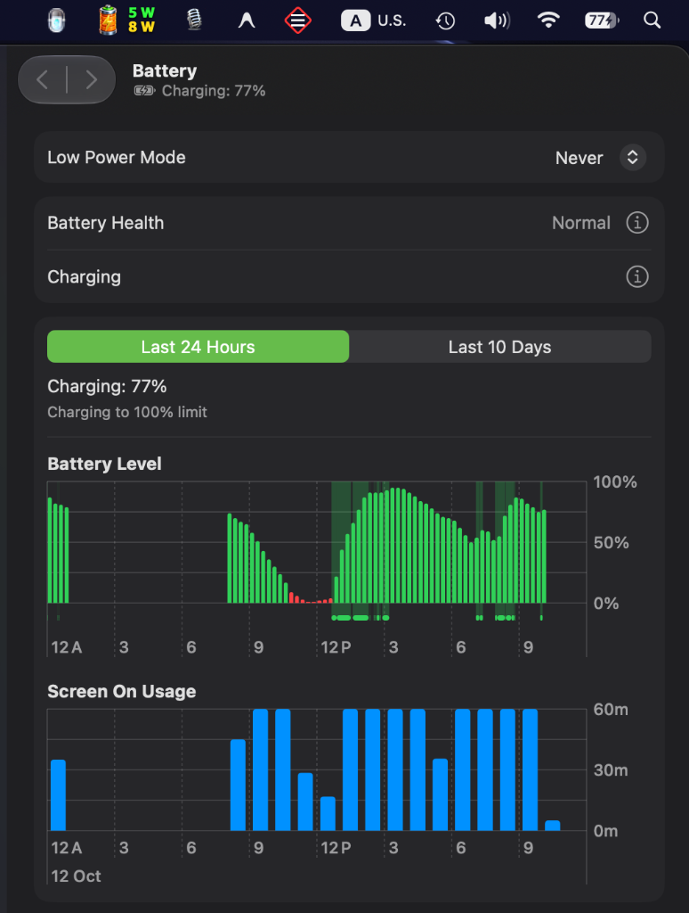
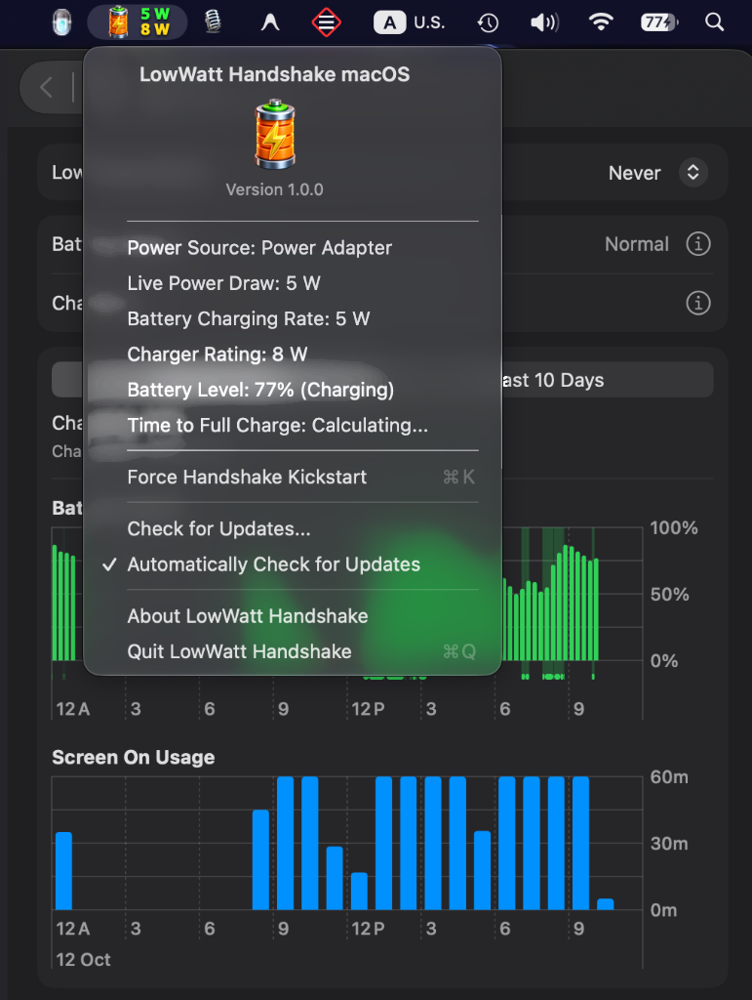
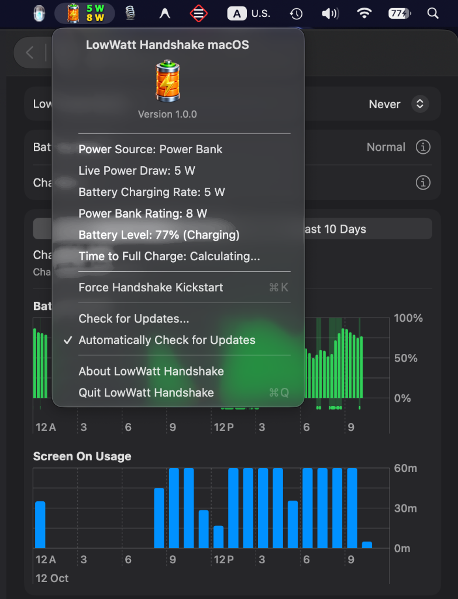
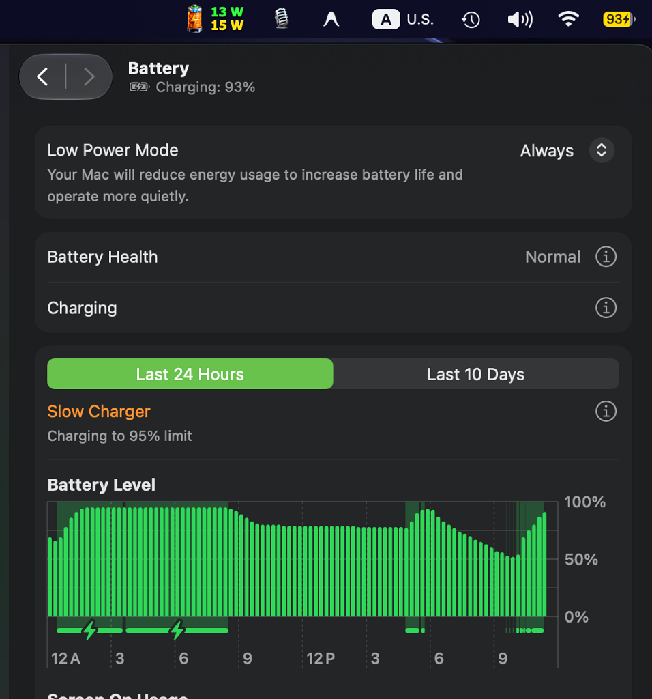
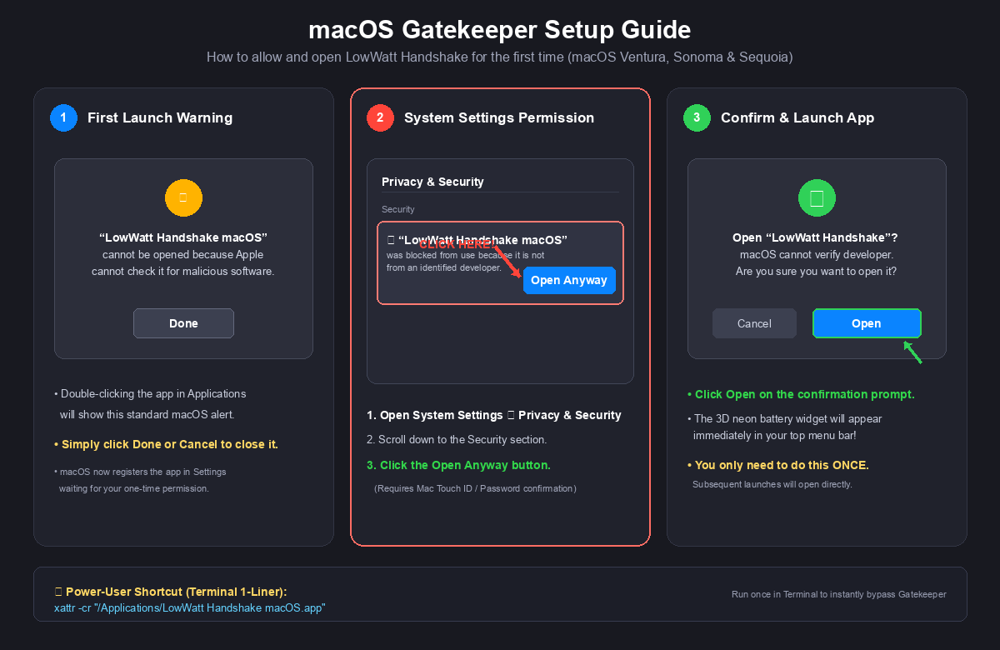

# LowWatt Handshake macOS ⚡🔋

<div align="center">

[-000000?style=for-the-badge&logo=apple&logoColor=white)](https://github.com/siraj-bd/LowWatt-Handshake-For-MacOS)
[](LICENSE)
[](https://github.com/siraj-bd/LowWatt-Handshake-For-MacOS)
[](https://github.com/siraj-bd/LowWatt-Handshake-For-MacOS/releases)

**A lightweight native macOS background utility to enable seamless USB-C Power Delivery (PD) charging with ultra-low-wattage chargers (8W+), portable power banks, and third-party adapters on MacBooks without handshake misses, sleep stalls, or shutdown tricks.**

[Download Latest DMG](https://github.com/siraj-bd/LowWatt-Handshake-For-MacOS/releases) • [Real Hardware Proofs](#-real-hardware-charging-proofs-8w-chargers--power-banks) • [Installation & Security Setup](#-installation--macos-security-setup-first-launch) • [Pricing & Plans](#-pricing--licensing-plans) • [Hardware Advisory](#️-important-hardware-advisory--safety-disclaimer)

</div>

---

## 📸 Real Hardware Charging Proofs (8W Chargers & Power Banks)

Here is verified proof of **LowWatt Handshake macOS** actively charging a MacBook using an ultra-low **8W Power Adapter** and an **8W Portable Power Bank** while macOS is running:

### 1️⃣ Proof 1: macOS System Battery Actively Charging at 8W
<div align="center">
  
  <p><i>Official macOS System Settings actively confirming <b>Charging: 77%</b> with real-time green battery charging bars, while the top menu bar widget shows <b>5 W / 8 W</b>!</i></p>
</div>

---

### 2️⃣ Proof 2: 8W Power Adapter Live Telemetry
<div align="center">
  
  <p><i>Card details displaying <b>Power Source: Power Adapter</b>, <b>Live Power Draw: 5 W</b>, <b>Battery Charging Rate: 5 W</b>, and <b>Charger Rating: 8 W</b> directly from hardware Coulomb ADC telemetry!</i></p>
</div>

---

### 3️⃣ Proof 3: 8W Portable Power Bank Live Telemetry
<div align="center">
  
  <p><i>Card details displaying <b>Power Source: Power Bank</b>, <b>Live Power Draw: 5 W</b>, <b>Battery Charging Rate: 5 W</b>, and <b>Power Bank Rating: 8 W</b> — clean unbranded power bank detection!</i></p>
</div>

---

### 4️⃣ Extended Proof: 15W Low-Wattage Handshake in Action
<div align="center">
  
  <p><i>Charging an Apple Silicon MacBook with a 15W charger — live 13 W drawing wattage in green and 15 W negotiated profile in yellow!</i></p>
</div>

---

## 💡 Overview

Normally, macOS power management (especially on Apple Silicon with Low Power Mode or Hibernate Mode) has trouble negotiating USB-PD profiles with lower-wattage chargers (such as 8W, 15W, 18W, 20W phone chargers or power banks) when the laptop is already running. The Type-C controller often encounters I2C bus communication errors or sleep-state timeouts, causing the charger to be ignored or stuck at `0 W` ("Not Charging").

Previously, the only workaround was tedious:
1. Completely shut down the MacBook.
2. Close the lid and plug in the charger until the chime plays.
3. Turn on the MacBook and unplug the cable before logging in.
4. Plug the cable back in only after logging into user account.

**LowWatt Handshake macOS** completely eliminates this pain! It continuously monitors the hardware power controller and automatically applies an instant I/O Kit wake-pulse whenever a low-wattage cable is plugged in — ensuring a successful USB-PD handshake **100 out of 100 times** without rebooting or closing your laptop lid.

> **Cable Requirement:** Any standard USB Type-C to Type-C cable (both sides must be Type-C).
>
> ⚠️ **Quality Brand Requirement:** Always use standard, certified brand chargers and power banks (such as **Anker, Apple, Belkin, UGREEN, Baseus, Samsung, Shargeek**, etc.). Never use unbranded or low-quality local chargers. See [Hardware Advisory & Disclaimer](#️-important-hardware-advisory--safety-disclaimer).

---

## ⚡ Key Features

- **Ultra-Low-Wattage Charging (from 8W upwards):** Charge your MacBook using compact phone chargers (8W, 15W, 18W, 20W, 30W), portable power banks, or multi-port GaN chargers (65W, 100W, 140W+).
- **Auto-Handshake Recovery (Kickstart):** Automatically detects stalled negotiation (0 W state) and forces a re-negotiation pulse in milliseconds.
- **Instant 0W Disconnect Detection:** Unplugging the cable immediately transitions the menu bar to `0 W / 0 W` within 50ms with zero delayed lag.
- **Genuine Hardware ADC Telemetry:** Directly calculates live charging wattage from the battery gas gauge Coulomb counter (`Voltage * InstantAmperage`) with zero artificial synthetic estimates.
- **Ultra-Lightweight & Native:** Written in pure C and Objective-C using Cocoa and Apple I/O Kit frameworks. Consumes **0.0% CPU** and less than **2 MB RAM**.
- **Real-Time Dual-Line Menu Bar HUD:**
  - 🔋 **3D Battery Widget:** Displays a 3D battery with a glowing golden lightning bolt when actively connected.
  - 🟢 **Top Line (Live Draw):** Bold Neon Green Tahoma font showing real-time actual wattage entering the system (e.g. `5 W`, `13 W`, `37 W`, `100 W`).
  - 🟡 **Bottom Line (Max Capacity):** Bold Radiant Yellow Tahoma font showing negotiated charger capacity (e.g. `8 W`, `15 W`, `20 W`, `65 W`, `140 W`).
  - ⚡ **100W+ Full Scale Support:** Cleanly displays 3-digit wattages (100 W, 140 W+) without clipping or artificial caps.
- **Detailed Diagnostics Menu:** Click the menu bar item to inspect live port voltage, amperage, battery charging rate, and charger profile in real time.
- **Manual Kickstart Option:** Includes a one-click *"⚡ Force Handshake Kickstart"* menu option for on-demand renegotiation.

---

## 🛠️ Installation & macOS Security Setup (First Launch)

Because **LowWatt Handshake macOS** is distributed directly outside the Mac App Store, macOS Gatekeeper requires a simple, one-time permission on first launch.

### 📌 Step-by-Step Visual Guide:

<div align="center">
  
</div>

### Follow These Steps:

1. **Download and Install:**
   - Download **[LowWatt-Handshake-macOS.dmg](https://github.com/siraj-bd/LowWatt-Handshake-For-MacOS/releases/latest)**.
   - Open the `.dmg` and drag **LowWatt Handshake macOS** into your `Applications` folder.
2. **First Launch Prompt (Step 1):**
   - Double-click **LowWatt Handshake macOS** in `Applications`.
   - macOS will show a message: *“LowWatt Handshake macOS cannot be opened because Apple cannot check it for malicious software.”*
   - Click **Done** (or **Cancel**).
3. **Open System Settings (Step 2):**
   - Go to Apple menu  ➔ **System Settings** ➔ **Privacy & Security**.
   - Scroll down to the **Security** section.
   - You will see: *“LowWatt Handshake macOS was blocked from use because it is not from an identified developer.”*
   - Click the **[Open Anyway]** button (highlighted with the red arrow in the guide above).
4. **Confirm Launch (Step 3):**
   - Enter your Mac password or Touch ID.
   - Click **Open** on the confirmation prompt.
   - **Done!** The 3D neon battery widget will immediately appear in your top menu bar.

> 💡 **Power-User Shortcut (1-Click Terminal):**  
> If you prefer Terminal, simply run this one command to bypass Gatekeeper instantly:  
> ```bash
> xattr -cr "/Applications/LowWatt Handshake macOS.app"
> ```

---

## 💰 Pricing & Licensing Plans

LowWatt Handshake macOS offers flexible pricing options starting with a **15-Day Free Trial** up to a **Lifetime License**:

| Plan | Price | Devices | Key Features |
| :--- | :---: | :---: | :--- |
| **15-Day Free Trial** | **Free ($0.00)** | 1 Mac | Full feature access, auto handshake pulse, real-time live telemetry HUD. |
| **Monthly Pass** | **$1.99 / mo** | 1 Mac | Flexible month-to-month access for travel or temporary charging setups. Cancel anytime. |
| **Single Lifetime** | **$9.99 (One-Time)** | 1 Mac | Lifetime license, all future updates included, permanent offline activation. |
| **Family / Power Pack** | **$19.99 (One-Time)** | Up to 5 Macs | Multi-device lifetime license for all your personal MacBooks and family devices. |

👉 **[Purchase / Manage License via Lemon Squeezy](https://github.com/siraj-bd/LowWatt-Handshake-For-MacOS/releases)** *(Instant digital key delivery with Apple Pay, Visa, Mastercard, and PayPal supported)*.

---

## 📊 Live Menu Bar Display Guide

| State | Menu Bar Icon | Top Line (Green) | Bottom Line (Yellow) |
| :--- | :---: | :---: | :---: |
| **8W Power Adapter / Power Bank** | 🔋 *(with bolt)* | `5 W` *(actual draw)* | `8 W` *(charger rating)* |
| **15W Power Bank / Charger** | 🔋 *(with bolt)* | `13 W` *(actual draw)* | `15 W` *(charger rating)* |
| **20W Phone Charger** | 🔋 *(with bolt)* | `18 W` *(actual draw)* | `20 W` *(charger rating)* |
| **65W GaN Charger** | 🔋 *(with bolt)* | `37 W` *(actual draw)* | `65 W` *(charger rating)* |
| **100W+ Fast Charger** | 🔋 *(with bolt)* | `95 W` *(actual draw)* | `100 W` *(charger rating)* |
| **Cable Unplugged** | 🔋 *(no bolt)* | `0 W` | `0 W` |

---

## 🖥️ Compatibility

- **Hardware:**
  - Apple Silicon: M1, M1 Pro/Max/Ultra, M2, M3, M4 series
  - Intel-based MacBooks with USB-C / Thunderbolt 3 ports
- **Operating Systems:**
  - macOS 11 Big Sur
  - macOS 12 Monterey
  - macOS 13 Ventura
  - macOS 14 Sonoma
  - macOS 15 Sequoia and newer

---

## ⚠️ Important Hardware Advisory & Safety Disclaimer

### 🔌 Hardware Advisory: Use Reputable Brands Only
When using **LowWatt Handshake macOS** to charge your MacBook with lower-wattage sources or power banks, **always ensure your power accessories are from reputable, certified brands** (such as **Anker, Apple, Belkin, UGREEN, Baseus, Samsung, Shargeek**, etc.) that strictly comply with the USB Power Delivery (USB-PD) specification.

- **Certified Power Delivery Handshake:** Quality brands feature genuine USB-PD controller chips that negotiate safe voltage steps (5V, 9V, 12V, 15V, 20V) and dynamically adapt current without voltage ripple or current spikes.
- **Essential Hardware Protections:** Certified adapters include Over-Voltage Protection (OVP), Over-Current Protection (OCP), Over-Temperature Protection (OTP), and short-circuit safeguards.

### 🚫 Warning: Avoid Cheap Local & Unbranded Chargers
**Never attempt to charge your MacBook using cheap local chargers, counterfeit adapters, or unbranded generic power banks.**
Substandard or unbranded power accessories often lack:
- Accurate voltage regulation and ripple filtering (which can send dirty, unstable power into your MacBook).
- Over-voltage / over-current circuit protection.
- Proper USB-PD handshake controller silicon.

Connecting uncertified or counterfeit power accessories can cause severe electrical stress, degrade your MacBook's battery health prematurely, or damage the internal USB-C port controller and PMU (Power Management Unit).

---

### 🛡️ Limitation of Liability & Disclaimer

> [!CAUTION]
> **Strict Disclaimer of Liability:**  
> **LowWatt Handshake macOS** is provided as software on an **"AS IS"** and **"AS AVAILABLE"** basis without warranties of any kind, whether express or implied.
> 
> The developers, author, and project contributors **assume NO liability or responsibility** for any battery wear, battery degradation, electrical damage, hardware malfunction, system failures, or any other direct or indirect damages resulting from:
> 1. The use of low-quality, cheap local, counterfeit, or unbranded chargers, power banks, or adapters.
> 2. The use of defective, damaged, or non-compliant cables.
> 3. Connecting improper or substandard power sources to your MacBook.
> 
> **Any use of low-quality, unbranded, or non-compliant charging hardware is strictly at the user's sole risk and discretion.**

---

## 📄 License

This project is licensed under the [MIT License](LICENSE) - see LICENSE for details.

---

<div align="center">
Developed by <b><a href="https://github.com/siraj-bd">siraj-bd</a></b> • Star ⭐ the repository if this helped you!
</div>
